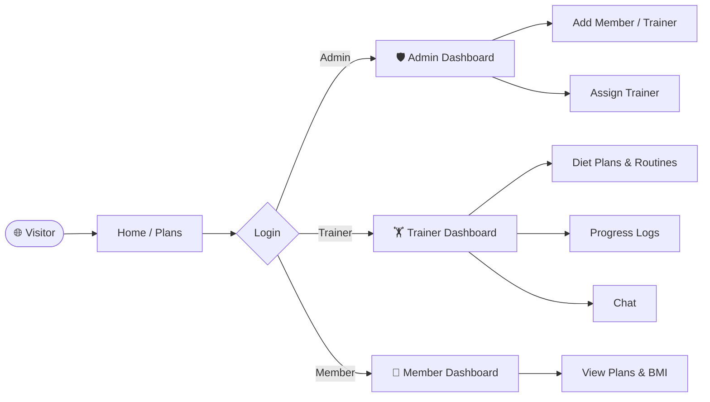
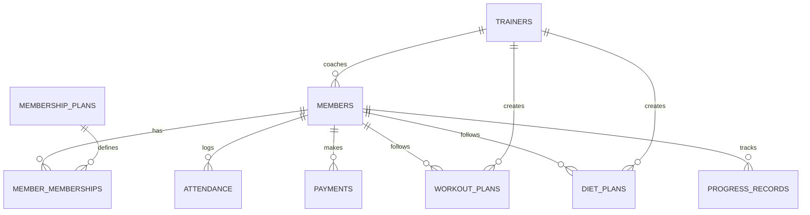

<div align="center">


# 🏋️ Gym Management System

**A modern, role-based web platform to run a gym — members, trainers, plans, progress and payments in one place.**


[🚀 Live Demo](#-live-demo) · [✨ Features](#-features) · [📸 Screenshots](#-screenshots) · [⚙️ Setup](#️-installation--setup) · [🗺️ Roadmap](#️-roadmap)

</div>

---

## 📑 Table of Contents

<details>
<summary><b>Click to expand</b></summary>

1. [About the Project](#-about-the-project)
2. [Live Demo](#-live-demo)
3. [Features](#-features)
4. [Pages Overview](#-pages-overview)
5. [Screenshots](#-screenshots)
6. [Tech Stack](#️-tech-stack)
7. [Project Structure](#️-project-structure)
8. [Planned Database](#️-planned-database)
9. [Installation & Setup](#️-installation--setup)
10. [Design System](#-design-system)
11. [Roadmap](#️-roadmap)
12. [Contributing](#-contributing)
13. [Author](#-author)

</details>

---

## 📖 About the Project

**IronPulse Gym** replaces paper registers and scattered spreadsheets with one digital platform. Admins manage members, trainers and assignments; trainers build workout routines and diet plans and track progress; members follow their plans and memberships.

| 🎯 Goal | 💡 How |
|---|---|
| Cut paperwork | Digital member, trainer and plan records |
| Better coaching | Custom diet plans, routines and progress logs per member |
| Clear operations | Dashboards with KPIs, expiring memberships and revenue |
| Great experience | Responsive dark UI with an energetic orange theme |

---

## 🚀 Live Demo

Run it instantly, no setup needed:

1. Open `html/index.html` in your browser **or** use VS Code **Live Preview** (the project is pre-configured in `.vscode/settings.json`).
2. Click **Login** and use the demo accounts below.

> 💡 **GitHub Pages:** go to *Settings → Pages → Deploy from branch → `main` / root*. Your demo will be at `https://<your-username>.github.io/Gym-Management-System/`.

### 🔑 Demo Credentials

| Role | Username | Password | Opens |
|:---:|:---:|:---:|---|
| 👤 Member | `member` | `member` | `member_dashboard.html` *(coming soon)* |
| 🏋️ Trainer | `trainer` | `trainer` | `trainer_dashboard.html` |
| 🛡️ Admin | `admin` | `admin` | `admin_dashboard.html` |

> ⚠️ Demo logins are front-end only. Real authentication (`password_hash` / `password_verify`) arrives with the PHP + MySQL backend.

---

## ✨ Features

> Click each module to expand 👇

<details open>
<summary><b>🛡️ Admin Module</b></summary>

- 📊 Dashboard with KPIs: total members, active trainers, new sign-ups, memberships expiring in 7 days, monthly revenue
- ➕ Add members with plan, goal, height, weight and trainer
- 🧑‍🏫 Add trainers with specialization, experience, salary and certificate upload
- 🔗 Assign trainers to members, with a trainers overview table
- 👤 Profile and password management
- ✅ Client-side form validation with toast notifications

</details>

<details>
<summary><b>🏋️ Trainer Module</b></summary>

- 📊 Dashboard with today's trainees and recent activity
- 👥 Assigned members list with live search and status badges
- ➕ Register new members
- ▶️ Content manager (videos / articles) with an add-content popup
- 🍎 Weekly **diet plan builder** that remembers each day's meals while you switch days
- 📈 **Progress logs** (weight, body fat, waist), report generation and recent reports
- 📅 **Workout routine builder**: add or remove exercises with sets, reps and rest
- 💬 **Chat** with members (demo replies)
- ⚙️ Profile and password management

</details>

<details>
<summary><b>👤 Member Module</b> <i>(planned)</i></summary>

- Registration and login
- View membership details and expiry
- View workout and diet plans from the trainer
- BMI calculator with saved history
- Attendance and payment history

</details>

<details>
<summary><b>🌐 Public Website</b></summary>

- Landing page: hero, offerings, trainers, testimonials, contact
- Membership plans and pricing (BDT ৳)
- Privacy Policy and Terms of Service
- Role-based login (Member / Trainer / Admin)

</details>

### 💳 Membership Plans

| Plan | Price | Highlights |
|:---:|:---:|---|
| Monthly | ৳2,000 | Full gym access, group classes |
| Quarterly | ৳5,400 | + Workout plan by trainer, 10% savings |
| 🔥 Yearly | ৳18,000 | + Diet plan, 2 free personal sessions |
| Day Pass | ৳150 | Single-day access |

---

## 🧭 Pages Overview

<details>
<summary><b>🌐 Public pages</b></summary>

| Page | File |
|---|---|
| Home | [`html/index.html`](html/index.html) |
| Membership Plans | [`html/membership.html`](html/membership.html) |
| Login | [`html/login.html`](html/login.html) |
| Admin Login | [`html/admin_login.html`](html/admin_login.html) |
| Privacy Policy | [`html/policy.html`](html/policy.html) |
| Terms of Service | [`html/terms.html`](html/terms.html) |

</details>

<details>
<summary><b>🛡️ Admin pages</b></summary>

| Page | File |
|---|---|
| Dashboard | [`html/admin_dashboard.html`](html/admin_dashboard.html) |
| Add Member | [`html/add_member.html`](html/add_member.html) |
| Add Trainer | [`html/add_trainer.html`](html/add_trainer.html) |
| Assign Trainer | [`html/assign_trainer.html`](html/assign_trainer.html) |
| Profile | [`html/admin_profile.html`](html/admin_profile.html) |

</details>

<details>
<summary><b>🏋️ Trainer pages</b></summary>

| Page | File |
|---|---|
| Dashboard | [`html/trainer_dashboard.html`](html/trainer_dashboard.html) |
| Members | [`html/trainer_members.html`](html/trainer_members.html) |
| Add Member | [`html/trainer_add_member.html`](html/trainer_add_member.html) |
| Content | [`html/trainer_content.html`](html/trainer_content.html) |
| Diet Plans | [`html/trainer_diet_plan.html`](html/trainer_diet_plan.html) |
| Progress Logs | [`html/trainer_progress.html`](html/trainer_progress.html) |
| Routine | [`html/trainer_routine.html`](html/trainer_routine.html) |
| Chat | [`html/trainer_chat.html`](html/trainer_chat.html) |
| Profile | [`html/trainer_profile.html`](html/trainer_profile.html) |

</details>

### 🔀 User Flow

---
## 📸 Screenshots

| Home | Membership Plans |
|:---:|:---:|
|  |  |

| Admin Dashboard | Trainer Dashboard |
|:---:|:---:|
|  |  |

## 🛠️ Tech Stack

| Layer | Technology | Purpose |
|:---:|:---:|---|
| 🎨 Frontend | HTML5, CSS3, Vanilla JS | Structure, styling, interactivity |
| ⚙️ Backend *(planned)* | PHP | Server logic, sessions, role-based access |
| 🗄️ Database *(planned)* | MySQL | Persistent data |
| 🖥️ Server | XAMPP (Apache + MySQL) | Local development |
| 🧰 Editor | VS Code + Live Preview | Instant preview |

---

## 🗂️ Project Structure

```
Gym-Management-System/
├── .vscode/
│   └── settings.json
├── css/
│   ├── style.css            # public website
│   ├── admin.css            # dashboard layout (admin + trainer)
│   └── trainer.css          # trainer extras (chat, modal, routines)
├── js/
│   ├── admin.js             # toast, form validation, helpers
│   └── trainer.js           # diet, routine, progress, chat logic
├── images/                  # logo, hero, class and trainer artwork (SVG)
├── html/
│   ├── index.html  login.html  membership.html  policy.html  terms.html
│   ├── admin_login.html  admin_dashboard.html  admin_profile.html
│   ├── add_member.html  add_trainer.html  assign_trainer.html
│   └── trainer_dashboard.html  trainer_members.html  trainer_add_member.html
│       trainer_content.html  trainer_diet_plan.html  trainer_progress.html
│       trainer_routine.html  trainer_chat.html  trainer_profile.html
├── index.html               # redirects to html/index.html
└── README.md
```

---

## 🗄️ Planned Database



Tables: `admins` · `members` · `trainers` · `membership_plans` · `member_memberships` · `attendance` · `payments` · `workout_plans` · `diet_plans` · `equipment` · `progress_records`

---

## ⚙️ Installation & Setup

<details open>
<summary><b>▶️ Quick start (front-end demo)</b></summary>

```bash
git clone https://github.com/<your-username>/Gym-Management-System.git
cd Gym-Management-System
```

Then either:
- double-click `index.html`, **or**
- open the folder in **VS Code** and start **Live Preview** (*Show Preview*).

</details>

<details>
<summary><b>🐘 Full-stack setup with XAMPP (once the PHP backend is added)</b></summary>

1. Install **XAMPP** and start **Apache** and **MySQL**.
2. Copy the project folder into `C:/xampp/htdocs/`.
3. Open **phpMyAdmin**, create a database named `gym_management`, then import `database.sql`.
4. Set your credentials in `config.php`:
   ```php
   $host = "localhost";
   $dbname = "gym_management";
   $username = "root";
   $password = "";
   ```
5. Visit `http://localhost/Gym-Management-System/`.

</details>

<details>
<summary><b>📤 Push this project to GitHub</b></summary>

```bash
git init
git add .
git commit -m "Initial commit: IronPulse Gym Management System"
git branch -M main
git remote add origin https://github.com/<your-username>/Gym-Management-System.git
git push -u origin main
```

</details>

---

## 🎨 Design System

| Token | Value | Use |
|---|---|---|
| 🟠 Accent | `#ff6a00` | Buttons, highlights |
| 🟡 Accent 2 | `#ff9a3c` | Gradients, hover |
| ⚫ Background | `#0f0f10` | Dashboards, navbar |
| 🔲 Card | `#1a1a1c` | Panels, tables |
| ⚪ Text | `#ffffff` / `#9a9aa3` | Primary / muted |

Fully responsive, with a sticky navbar, smooth scrolling, hover animations and `prefers-reduced-motion` support.

---

## 🗺️ Roadmap

- [x] Public website (home, plans, policy, terms)
- [x] Role-based login screen
- [x] Admin module UI
- [x] Trainer module UI
- [ ] Member module UI (dashboard, plans, BMI, attendance, payments)
- [ ] PHP + MySQL backend with secure authentication
- [ ] Attendance tracking and QR check-in
- [ ] Payment records and receipts
- [ ] Equipment inventory management
- [ ] Email / SMS notifications for expiring memberships
- [ ] Online payment gateway (bKash / card)
- [ ] Charts and advanced analytics (Chart.js)
- [ ] Multi-branch support

---

## 🤝 Contributing

Contributions are welcome!

1. 🍴 Fork the repository
2. 🌿 Create a branch: `git checkout -b feature/amazing-feature`
3. 💾 Commit: `git commit -m "Add amazing feature"`
4. 📤 Push: `git push origin feature/amazing-feature`
5. 🔁 Open a Pull Request

---

## 👩‍💻 Author

**Ibtida Ara**
GitHub: [@IbtidaAra5](https://github.com/IbtidaAra5)

---

## 📄 License

This project is created for educational purposes.

<div align="center">

⭐ **If you like this project, give it a star!** ⭐

<a href="#-gym-management-system">⬆ Back to top</a>

</div>
